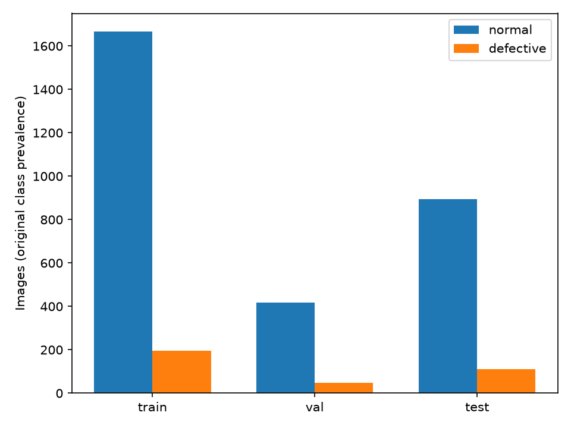
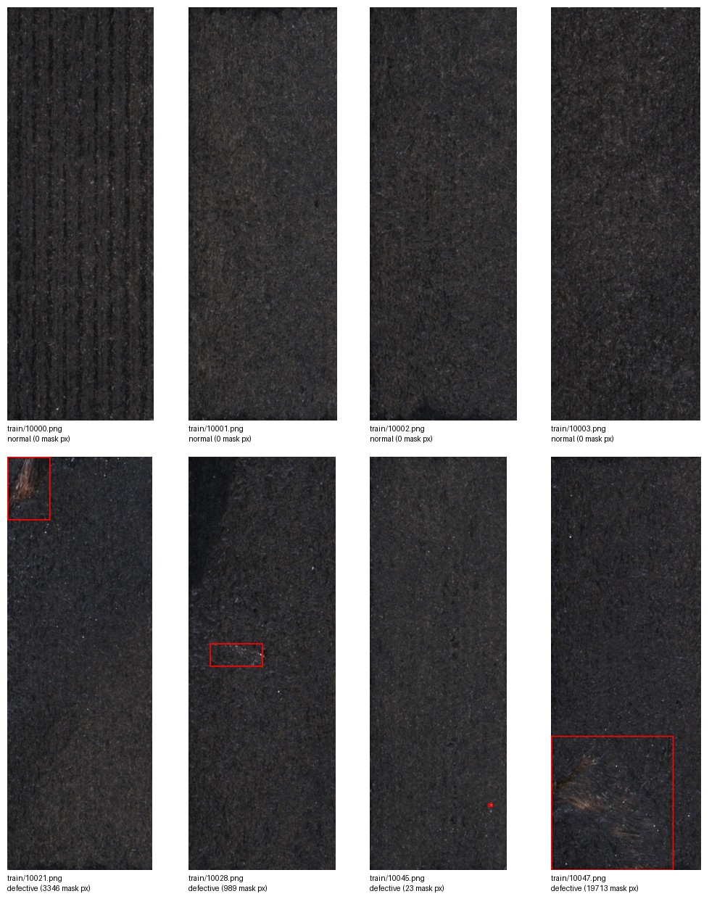
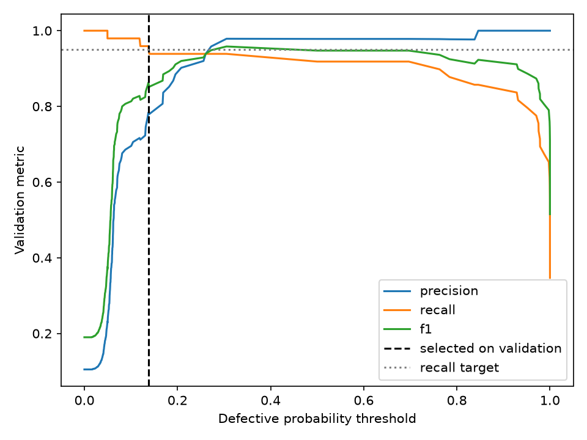
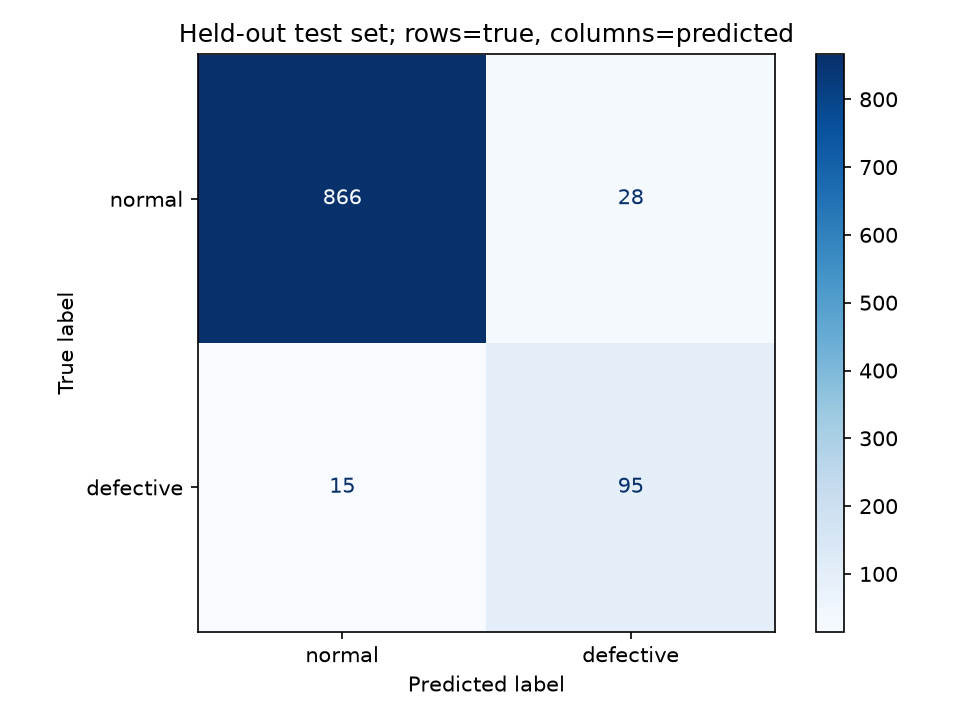
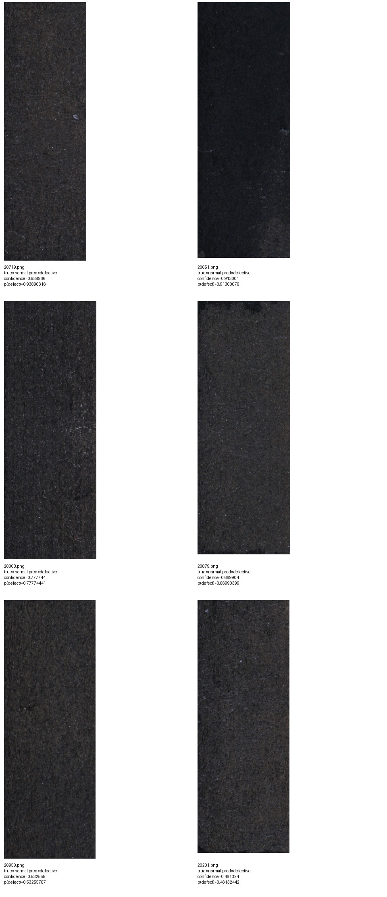
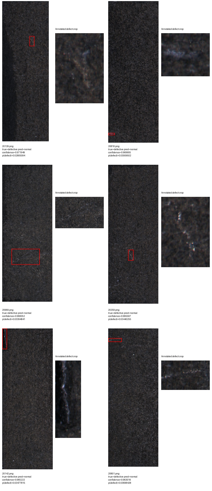
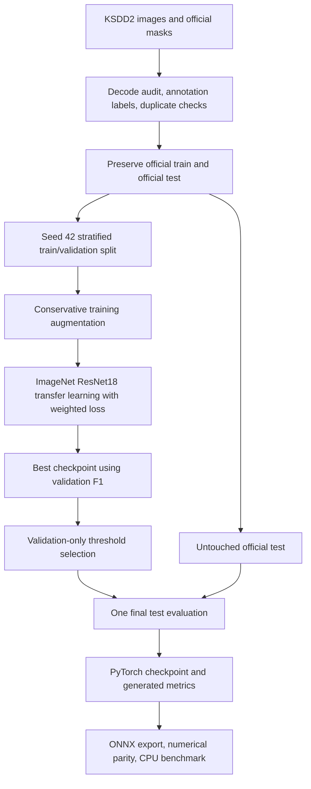
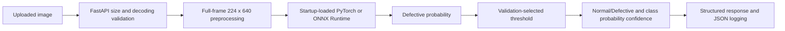

# Manufacturing surface-defect classification

[](https://github.com/sohaib-0897/industrial-defect-detection/actions/workflows/ci.yml)

The assessment specification stated that a dataset would be provided, but no dataset was included in the supplied materials. After requesting access and not receiving it within the submission window, the publicly available Kolektor Surface-Defect Dataset 2 (KSDD2) was used to demonstrate the complete pipeline. The training and inference code is dataset-agnostic and can be retrained on the intended dataset.

Classify an inspection image as **normal** (0, no visible defect) or **defective** (1, visible defect). Defective is the positive class everywhere. This submission includes a trained transfer-learning model, audited splits, generated evaluation evidence, FastAPI inference, verified ONNX export, and CPU measurements. Synthetic fixtures are used only for software tests; they contribute no assessment metrics below.

## Dataset and split integrity

[KSDD2 official source](https://www2.vicos.si/resources/kolektorsdd2/) · [official ZIP](https://data.vicos.si/datasets/KSDD/KolektorSDD2.zip).
Kolektor captured and annotated real production surfaces under controlled industrial conditions. Defects include scratches, spots and surface imperfections. This public substitute was **not supplied by Spark AI**.

License: **Creative Commons Attribution-NonCommercial-ShareAlike 4.0 International (CC BY-NC-SA 4.0)**. Commercial dataset use requires contacting the authors; public availability does not grant commercial rights. This repository's example/contact-sheet figures derive from that dataset and retain the same attribution and license. Citation: Jakob Božič, Domen Tabernik, Danijel Skočaj, “Mixed supervision for surface-defect detection: from weakly to fully supervised learning”, *Computers in Industry*, 2021.

| Partition | Normal | Defective | Total |
|---|---:|---:|---:|
| Official training (before subdivision) | 2,085 | 246 | 2,331 |
| Training | 1,667 | 197 | 1,864 |
| Validation | 418 | 49 | 467 |
| Official test, preserved | 894 | 110 | 1,004 |
| Entire canonical dataset | 2,979 | 356 | 3,335 |

The official archive contains an extra byte-identical `10301 (copy).png` and its mask. Both hashes match their canonical originals; the audit records and excludes the duplicate pair. Canonical counts match the official documentation. All 3,335 RGB PNG images and grayscale masks decode successfully; masks contain 0 and 255, and **any nonzero annotation pixel defines defective**. Actual widths range 184–241 pixels; heights 597–665 pixels (approximately 230 × 630). No further exact decoded image duplicates were found.

Normal:defective imbalance is **8.37:1** overall and **8.46:1** in training. An always-normal test classifier already reaches 89.04% accuracy while detecting no defects; defective precision, recall and F1 are therefore essential.

Only the official training directory is subdivided, with scikit-learn stratification, 20% validation and **seed 42**. [Frozen manifest](reports/ksdd2/splits.csv) stores image and mask hashes, labels and membership; loaders reject changed data, duplicate paths and cross-split groups. The official test is excluded from optimization, early stopping, preprocessing/augmentation decisions, model selection and threshold tuning. Training examples alone informed preprocessing. Test evaluation is protected against accidental overwrite. Exact duplicate checks cannot establish independent physical products; product/session IDs and comprehensive near-duplicate verification are unavailable.




Full observed dimensions, annotation details and duplicate evidence: [dataset audit](reports/ksdd2/dataset_analysis.md), [machine-readable audit](reports/ksdd2/dataset_analysis.json).

## Preprocessing, model and training

Use aspect-preserving bilinear resize with padding to **224 pixels wide × 640 high**. Keep the complete frame; no square squash or crop. Padding uses approximately the ImageNet mean RGB, followed by ImageNet normalization. Typical images retain almost their original resolution. Downsampling can still weaken extremely small defects. Validation, test and both inference backends share deterministic preprocessing, enforced by checkpoint metadata.

Final training augmentation: **±10% brightness/contrast jitter**, followed by deterministic full-frame padding. No flips, rotation, random crop, blur, erasing or artificial defects. A validation-only pilot using ±2° expanded rotations introduced conspicuous gray padding changes and poor early operating-point behavior. I inspected the transformed training images and compared a conservative photometric-only run before touching the test set; the [experiment report](reports/ksdd2/augmentation_review.json) records the validation evidence. Orientation plausibility was not assumed.

**ImageNet1K_V1-pretrained ResNet18**, with a two-output classification head, provides a lightweight, CPU-deployable baseline for only 197 training positives. No architecture search was performed. Train the head for one epoch; then unfreeze the backbone and head, using a ten-times lower backbone learning rate. BatchNorm running statistics stay fixed. A final-stage-only pilot had a poor high-recall operating point; the full-backbone option was assessed using validation data before final test evaluation. No test observations informed this decision.

Weighted cross-entropy uses `N/(2*n_class)`: **normal=0.559088, defective=4.730964**. Training batches remain shuffled at natural prevalence. Validation and test prevalence is unchanged.

| Setting | Actual run |
|---|---|
| Seed / device / batch size / CPU threads | 42 / cuda / 16 / 4 |
| Optimizer | AdamW, weight decay 0.0001 |
| Head LR / backbone LR | 0.001 / 0.0001 |
| Epoch cap / early-stop patience | 10 / 3 |
| Scheduler | ReduceLROnPlateau on validation F1, factor 0.5, patience 2 |
| Checkpoint rule | Highest defective validation F1 at 0.5; ties use lower validation loss |
| Epochs completed / selected epoch | 8 / 5 |

Logs retain training loss, training metrics, validation loss, accuracy, precision, recall, F1 and learning rates. [Configuration](reports/ksdd2/config.json) · [epoch history](reports/ksdd2/history.json). Weighted loss is aggregated using its effective weight denominator, avoiding incorrect averages of weighted batch means. Random seeds and deterministic PyTorch operations are fixed; numerical identity across platforms is not promised.

## Validation-only operating threshold

After choosing the checkpoint, examine every distinct validation probability boundary plus 0, 0.5 and 1. Select maximum precision subject to **defective recall ≥95%**; ties use F1 then the highest threshold. The selected threshold is **0.13742648**, with validation precision **78.33%**, recall **95.92%** and F1 **86.24%**.

A false negative may ship a defective product to a customer. A false positive may unnecessarily reject a good item or trigger manual review. The 95% target is a predeclared QC preference, not a production cost optimum. With only 49 validation defects, recall changes in steps of 2.04 percentage points; the 95% target requires at least 47 correct detections (95.92%). The threshold is never tuned on test labels and probability-based confidence is not calibrated certainty. [Complete threshold sweep and validation predictions](reports/ksdd2/threshold_selection.json).



## Final untouched official test results

One final test evaluation after checkpoint and threshold selection:

| Metric (defective positive) | Measured |
|---|---:|
| Accuracy | 95.72% |
| Precision | 77.24% |
| Recall | 86.36% |
| F1 | 81.55% |
| True negatives / false positives | 866 / 28 |
| False negatives / true positives | 15 / 95 |
| Support | 894 normal, 110 defective |

Confusion matrix (rows = ground truth; columns = prediction, order normal/defective):
`[[866, 28], [15, 95]]`.



[Generated metrics and hashes](reports/ksdd2/evaluation.json) · [classification report](reports/ksdd2/classification_report.json) · [every image prediction](reports/ksdd2/test_predictions.json). These files are generated from model outputs; quality metrics are not manually edited.

The validation recall target did **not** generalize to the official test: recall fell from 95.92% to 86.36%. Fifteen of 110 defective test images were missed. This operating point is a measured baseline, not a production acceptance guarantee; it was retained without test-driven tuning.

Post-evaluation descriptive ranking statistics from the already saved predictions: **Average Precision 0.8955**, **ROC-AUC 0.9257**. Average Precision uses the stepwise precision-recall summary, not trapezoidal PR-AUC. No inference or selection was repeated; these statistics do not change the operating point or primary results. Confidence intervals are omitted because independent product/session sampling is not established. [Stored statistics and prediction hash](reports/ksdd2/post_evaluation_statistics.json).

## Actual error review

Visually inspected six highest-confidence false positives and six highest-confidence false negatives, using full images and enlarged annotation crops. All 43 errors are recorded; descriptive notes apply only to inspected examples.

**False positives:** normal images show pale flecks, strong vertical/diagonal striations, mottled texture and uneven brightness. Examples include the isolated fleck in `test/20719.png` and pronounced vertical texture in `test/20008.png`. Their official masks are empty. These cues resemble defect patterns visually; this does not establish label errors or the classifier's causal mechanism.

**False negatives:** several misses are thin, small or weak-contrast marks, including `test/20816.png` (181 annotated pixels) and `test/20259.png` (323 pixels). The scratch in `test/20142.png` lies along the upper-left boundary. `test/20969.png` has a larger, low-contrast patch (3,390 pixels), so size alone does not explain all misses. The full frame is preserved; no crop removed these regions. Network downsampling/global pooling may weaken localized cues, but that remains a hypothesis.

| Filename | Ground truth | Prediction | p(defective) | Class probability confidence | Annotated pixels |
|---|---|---|---:|---:|---:|
| test/20139.png | defective | normal | 0.028051 | 0.971949 | 559 |
| test/20142.png | defective | normal | 0.034778 | 0.965222 | 1763 |
| test/20259.png | defective | normal | 0.034403 | 0.965597 | 323 |
| test/20801.png | defective | normal | 0.036984 | 0.963016 | 429 |
| test/20816.png | defective | normal | 0.030095 | 0.969905 | 181 |
| test/20969.png | defective | normal | 0.033948 | 0.966052 | 3390 |
| test/20008.png | normal | defective | 0.777744 | 0.777744 | 0 |
| test/20201.png | normal | defective | 0.461324 | 0.461324 | 0 |
| test/20651.png | normal | defective | 0.913001 | 0.913001 | 0 |
| test/20719.png | normal | defective | 0.938966 | 0.938966 | 0 |
| test/20879.png | normal | defective | 0.669904 | 0.669904 | 0 |
| test/20950.png | normal | defective | 0.532558 | 0.532558 | 0 |




Findings were recorded after the final test evaluation. No threshold adjustment, retraining or model selection followed this review.


Error records contain filename, ground truth, prediction, defective probability and class-probability confidence. Contact sheets preserve full images and show annotation locations where present. Test error review is descriptive and did not trigger retraining or threshold changes. [Error records](reports/ksdd2/errors/errors.json). Optional [Grad-CAM diagnostics](reports/ksdd2/gradcam) are post-evaluation illustrations of coarse final-layer attention, not causal explanations or a segmentation result.

## Architecture and API






Masks supply binary training labels and post-evaluation review annotations. They are never inference inputs.


FastAPI validates multipart bodies before parsing and limits image uploads to 8 MiB. It checks supported image types, decoding, single frames and pixel limits. One model is loaded at startup. CPU inference is serialized per worker; use one uvicorn worker to avoid loading multiple copies. Structured logs record prediction outputs without retaining uploaded images.

`GET /health`: 200 when ready, 503 when the model is unavailable. `POST /predict`: multipart field `file`; 200 success, 413 oversized upload, 415 unsupported declared media type, 422 malformed image/missing field, 503 unavailable model. Response includes `predicted_class`, `confidence`, `defect_probability`, `decision_threshold`, `inference_time_ms`, `model_version`. Confidence equals `p(defective)` for a defective decision and `1-p(defective)` for a normal decision, even with a threshold below 0.5.

## Setup and complete reproduction

Python 3.12. CPU deployment measurements used Windows-11-10.0.26200-SP0, Intel64 Family 6 Model 186 Stepping 2, GenuineIntel (Intel Core i5-13420H), PyTorch 2.14.0+cpu. Training used NVIDIA GeForce RTX 4050 Laptop GPU with PyTorch 2.14.0+cu130. The CUDA wheel step follows [PyTorch's official installation index](https://pytorch.org/get-started/locally/); omit it and use `--device cpu` on a CPU-only machine. Run in the repository root (PowerShell):

```powershell
git clone https://github.com/sohaib-0897/industrial-defect-detection.git
cd industrial-defect-detection
python -m venv .venv
.\.venv\Scripts\Activate.ps1
python -m pip install -r requirements-dev.txt -c constraints.txt
python -m pip install --no-deps torch==2.14.0+cu130 torchvision==0.29.0+cu130 --index-url https://download.pytorch.org/whl/cu130
python -m scripts.download_ksdd2
python -m src.ksdd2
python -m src.train --data data/KolektorSDD2 --manifest reports/ksdd2/splits.csv --output artifacts/reproduced --epochs 10 --freeze-epochs 1 --backbone-mode all --rotation-degrees 0 --batch-size 16 --lr 0.001 --patience 3 --target-recall 0.95 --seed 42 --threads 4 --device cuda
python -m src.evaluate --data data/KolektorSDD2 --manifest reports/ksdd2/splits.csv --checkpoint artifacts/reproduced/best.pt --threads 4
python -m src.error_analysis --data data/KolektorSDD2 --run artifacts/reproduced
python -m src.export_onnx --checkpoint artifacts/reproduced/best.pt --samples data/KolektorSDD2/train/10000.png data/KolektorSDD2/train/10021.png
python -m src.benchmark --checkpoint artifacts/reproduced/best.pt --sample data/KolektorSDD2/train/10000.png --threads 2 --warmup 10 --repeats 50
python -m scripts.check_api --checkpoint artifacts/reproduced/best.pt --sample data/KolektorSDD2/train/10000.png --additional-samples data/KolektorSDD2/train/10021.png
python -m scripts.check_api --checkpoint artifacts/reproduced/best.pt --sample data/KolektorSDD2/train/10000.png --additional-samples data/KolektorSDD2/train/10021.png --backend onnx
```

Choose a fresh run directory; training rejects existing results and evaluation refuses overwriting the final test report. The locally completed submission checkpoint is `artifacts/run-001/best.pt`. Raw images, ZIPs, caches and large model artifacts are ignored in Git. Reproduction generates the checkpoint; no artifact/release remote is configured. Download/extraction alone requires roughly 2 GiB; CPU training requires additional memory and takes substantially longer than GPU training. For a different supplied dataset, use the generic `src.analyze_data` CSV/folder audit and the same training/inference architecture; KSDD2 uses its dedicated official-split adapter.

For a fresh clone, the commands above generate `artifacts/reproduced/best.pt`; use that path for API startup, and `artifacts/reproduced/best.onnx` for ONNX. To build the Docker image, copy `best.pt`, `best.onnx` and `best.json` into `artifacts/run-001/`, the image's documented checkpoint directory. The original submission machine already has these files. Trained weights are deliberately excluded from Git; the API cannot make predictions until a checkpoint has been reproduced.

Trained `.pt` and `.onnx` artifacts are intentionally excluded from Git and generated by the reproduction commands. They may be supplied separately for the assessment if the submission channel supports attachments.

Start the local submission API:

```powershell
$env:MODEL_PATH = 'artifacts/run-001/best.pt'
$env:INFERENCE_BACKEND = 'pytorch'
python -m uvicorn app.main:app --host 127.0.0.1 --port 8010
```

In another terminal:

```powershell
curl.exe --noproxy "*" http://127.0.0.1:8010/health
curl.exe --noproxy "*" -X POST http://127.0.0.1:8010/predict -F "file=@data/KolektorSDD2/train/10000.png;type=image/png"
curl.exe --noproxy "*" -X POST http://127.0.0.1:8010/predict -F "file=@data/KolektorSDD2/train/10021.png;type=image/png"
```

For ONNX set `MODEL_PATH=artifacts/run-001/best.onnx` and `INFERENCE_BACKEND=onnx` before startup. [Natural 2–3 minute recording script](docs/demo_script.md).

## ONNX parity and CPU latency

Export uses opset 17 and a dynamic batch axis. ONNX checker and Runtime verify random batches and real normal/defective images. Maximum absolute logit difference: **3.3378601e-06**; all compared probability/class decisions agree within `atol=1e-5, rtol=1e-4`. Export metadata stores checkpoint/ONNX hashes, threshold and preprocessing contract. The API rejects a changed ONNX file.

| Backend | Median | p95 |
|---|---:|---:|
| PyTorch CPU | 492.79 ms | 585.15 ms |
| ONNX Runtime CPU | 310.01 ms | 416.86 ms |

Batch size 1, two CPU threads, 10 warmups, 50 timed runs. Scope: RGB preprocessing + model + threshold; excludes decoding, HTTP and startup. Results describe this laptop and its load, not production throughput. [Raw benchmark environment and results](reports/ksdd2/benchmark.json).

## Packaging and software checks

```powershell
docker compose config -q
docker compose up --build -d
curl.exe --noproxy "*" http://127.0.0.1:8011/health
curl.exe --noproxy "*" -X POST http://127.0.0.1:8011/predict -F "file=@data/KolektorSDD2/train/10021.png;type=image/png"
docker compose down
python -m pytest -q
python -m ruff check .
python -m ruff format --check .
```

Docker uses CPU wheels, a non-root user, read-only Compose filesystem and readiness health check. Only required model artifacts enter the build context; data and training caches stay outside the image. [Executed verification and exact Docker status](docs/verification.md). Tests cover preprocessing, mask-derived classes, official test preservation, threshold boundaries, model outputs, API readiness, invalid/oversized/corrupt uploads and ONNX metadata/parity. Separate live HTTP checks exercise real normal/defective images through both backends. Synthetic unit fixtures test software behavior only.

Latest local verification: **21 tests passed**, **Ruff lint and format passed**, **ONNX parity passed**, and **Docker build/startup and real prediction checks passed**. GitHub Actions runs Python 3.12, pinned CPU/runtime/development dependencies, `pip check`, pytest and both Ruff checks on pushes to main and pull requests. CI never downloads KSDD2 or trains a model; its tests build temporary software fixtures and audit committed evidence. Only the downloaded-data integration test skips without KSDD2.

## Licensing

Repository-authored source code is licensed under [MIT](LICENSE). KSDD2 remains subject to its official **CC BY-NC-SA 4.0** terms; the MIT source-code license does not cover the dataset. Dataset-derived figures, contact sheets and reports remain subject to applicable KSDD2 terms; see [dataset attribution](reports/ksdd2/LICENSE.md). This section makes no separate licensing claim about trained weights.

## Limits and next steps

This is one industrial domain with only 197 training defects and 49 validation defects; transfer to a new factory is unproven. Small spots and weak scratches can remain below the classifier's effective resolution. Binary classification provides no reliable defect localization. Threshold and confidence need calibration to actual inspection costs. License limits dataset-derived commercial use. Before deployment, collect independent production batches and the intended assessment data, validate product/session separation, repeat training across seeds and compare tiled higher-resolution inference on validation data, calibrate probabilities, and monitor illumination/domain drift. Any new model selected after test review requires a fresh holdout.
