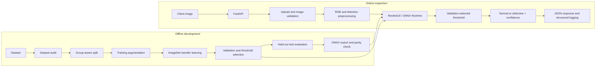

# Manufacturing visual defect detection

Binary inspection: `normal` (index 0) versus `defective` (index 1). The submission implements an auditable training pipeline and a CPU FastAPI service with PyTorch and ONNX Runtime backends.

**Assessment status (rechecked 2026-10-04):** the real assessment dataset could not be located in the repository or accessible local locations searched, including common user folders, temporary upload locations and ZIP contents. The repository contains only previously generated synthetic fixtures and plots. Real dataset statistics, manufacturing metrics, operating threshold and failure patterns remain blocked. Historical smoke results are isolated in [smoke-only verification](docs/smoke_verification.md) and must not be presented as assessment results. See [dataset audit](artifacts/dataset_analysis.md) and [verification report](artifacts/verification.json).

| Assessment result | Status |
|---|---|
| Real images / class distribution / dimensions / formats | Dataset not located in accessible searched locations |
| Real train / validation / test counts | Pending dataset audit |
| Real accuracy / precision / recall / F1 | Not measured |
| Real confusion matrix / FP / FN findings | Not measured |
| Real operating threshold | Must be selected on validation data |

**Current software checks:** 14 tests passed; Ruff lint/format and Docker Compose configuration checks passed. Real training, test evaluation, ONNX parity, latency and API predictions require the missing dataset and its trained checkpoint. Docker build/start additionally requires the Docker engine, which is unavailable. No synthetic quality or latency values are reported as real results here.

## Dataset audit and splits

`src.analyze_data` recursively inventories the supplied directory. It logs formats, dimensions after EXIF correction, corrupt files, SHA-256 and decoded-pixel duplicates, dHash near-duplicates (Hamming distance ≤2), label conflicts and merged group counts. Corrupt images are listed and excluded; unknown labels and exact duplicates with conflicting labels block splitting. Near-duplicates are conservatively kept together. Exhaustive near-duplicate search is limited to 5,000 labeled images; larger datasets explicitly report that this step was skipped.

Folder names `normal/good/ok` and `defective/defect/bad/ng` map to binary labels, case-insensitively. Other layouts require a CSV; no arbitrary defect folder is silently relabeled. Example:

```csv
path,label,group
captures/item17_front.png,normal,product17
captures/item17_back.png,normal,product17
captures/item18_front.png,defective,product18
```

Use `--metadata metadata.csv` for explicit product/batch/session groups, or `--group-regex 'product_(\d+)'` to capture IDs from relative paths. Groups must identify the physical capture unit **across classes and folders**. Inspect the actual filenames and metadata before choosing this option. Without IDs, each image starts as a group and duplicate links merge groups; this cannot establish that different views show different products. Review the near-duplicate list because low-texture images may be over-grouped.

Seed 42 fixes 256 candidate group splits. The chosen candidate minimizes deviation from 70/15/15 **within each class**, while requiring both classes in every partition. Group integrity takes precedence over exact percentages. Small or over-grouped datasets fail with an actionable message instead of producing misleading splits. `splits.csv` freezes relative paths, labels, groups, file hashes and membership. Training/evaluation reject changed files and cross-split groups; evaluation also checks the manifest against the training checkpoint.

## Preprocessing, imbalance and model

Images become EXIF-corrected RGB and are letterboxed to 224×224 using bilinear interpolation and neutral padding, followed by ImageNet mean/std normalization. This intentionally replaces torchvision's default center crop: an edge defect must remain visible. Letterboxing may shrink tiny defects and introduces padding; inspect these risks on real images.

Training adds ±5° rotation, ±2% translation, and ±10% brightness/contrast. No flips are enabled because product symmetry is unknown; no random crop, erasing or blur removes defects. Mild rotations can still clip extreme corners: review the augmentation on the supplied products and disable it if corner inspection is critical. Validation/test/service transformations are deterministic and shared.

ResNet18 starts from `ResNet18_Weights.IMAGENET1K_V1`, with its 512-feature classifier replaced by two logits. Its conventional residual backbone is easy to explain and export; approximately 11.2M parameters are reasonable for a baseline and CPU deployment. MobileNetV3 is a future option if measured line-rate latency demands it. See [torchvision ResNet18 documentation](https://docs.pytorch.org/vision/stable/models/generated/torchvision.models.resnet18.html).

Measure imbalance on **training only**. If majority/minority ≥1.5, weighted cross-entropy uses `N / (2 × class_count)`; otherwise weights are `[1,1]`. Counts, ratio and actual weights are logged and stored. The cutoff is a pragmatic configurable-in-code policy, not a statistical law. No oversampling duplicates minority images or alters validation/test prevalence.

## Training, threshold and evaluation

Default training uses two frozen-backbone epochs, then full fine-tuning. AdamW uses head LR `1e-3`, backbone LR `1e-4`, weight decay `1e-4`; ReduceLROnPlateau halves LR after stalled validation F1. BatchNorm running statistics remain fixed for small batches. Epoch logs record train/validation loss, defect precision/recall/F1, accuracy and learning rates. Best checkpoint maximizes validation F1 at 0.5, with lower validation loss breaking ties; patience 5 stops after the unfrozen phase starts. Random generators, worker seeds and deterministic torch algorithms are configured; CPU is automatic when CUDA is absent. Reproducibility is expected within the same software/hardware environment, not across every backend.

Only the selected checkpoint's **validation** probabilities determine the operating threshold. The default policy maximizes precision while reaching empirical defect recall ≥95%, breaking ties by F1 then the highest threshold. `--target-recall` changes this assumption. All unique probability boundaries plus 0, 0.5 and 1 are inspected, and the full trade-off is saved in `threshold_selection.json`. Checkpoint selection at 0.5 is deliberately separate from this operating policy; a future study can select checkpoints by cost-weighted validation utility.

A false positive sends a normal item to rejection/manual review; a false negative lets a defective item through. The default favors recall because escaped defects can be expensive, while precision constrains review load. A threshold can satisfy recall by flagging almost everything; the saved precision must always be reviewed. A small validation sample cannot establish 95% production recall. Confidence is the predicted class softmax probability, **not calibrated certainty**. At a threshold below 0.5, a `defective` prediction can correctly have confidence below 0.5; `defect_probability` removes ambiguity.

`src.evaluate` uses the stored threshold and test split once. It writes `evaluation.json`, per-image `test_predictions.json`, and `confusion_matrix.png` (rows=true; columns=predicted). It refuses to overwrite an existing evaluation. A failed evaluation leaves an `evaluation_in_progress` marker: diagnose the failure before removing that file and retrying. Do not tune against test results. Reports include per-class metrics and a small-sample warning.

`src.error_analysis` consumes saved predictions without repeating model evaluation. It saves all FP/FN filenames, labels, confidence and defect probability, plus highest-confidence example sheets and brightness/contrast cues. Review lighting, blur, small or low-contrast defects, background, orientation, occlusion, label noise and product domains. Cues are not causal conclusions. **Real failure analysis is pending the missing dataset.** Update the assessment results above and embed `artifacts/run-001/confusion_matrix.png` after real evaluation; use a fresh holdout if findings drive retraining.

## Architecture



## Structure

```text
app/          configuration, startup, validation, inference, response schema
src/          audit, data, model, training, metrics, evaluation, error analysis, ONNX, benchmark
scripts/      synthetic fixtures, real HTTP check, end-to-end verification
tests/        preprocessing, split/leakage, mapping, model, threshold and API tests
artifacts/    local run outputs; ignored except concise initial audit/verification
docs/         recording script and measured verification notes
```

## Setup and reproduce

Python 3.12. Run from the repository root. These pinned versions match the tested environment; `constraints.txt` also pins the installed transitive dependencies. For a clean Windows environment:

```powershell
python -m venv .venv
.\.venv\Scripts\Activate.ps1
python -m pip install -r requirements-dev.txt -c constraints.txt
```

Linux activation: `source .venv/bin/activate`. For CPU-only Linux install torch/torchvision from `https://download.pytorch.org/whl/cpu` first, as in the Dockerfile. GPU builds require the appropriate PyTorch wheel for your CUDA environment.

Place the assessment data in `data/` (ignored), then execute in this order. Add `--metadata data/metadata.csv` or `--group-regex` to the audit when captures share a product/session. Set the sample path to an actual image.

```bash
python -m src.analyze_data --data data --output artifacts
python -m src.train --data data --manifest artifacts/splits.csv --output artifacts/run-001 --epochs 20 --freeze-epochs 2 --batch-size 16 --lr 0.001 --target-recall 0.95
python -m src.evaluate --data data --manifest artifacts/splits.csv --checkpoint artifacts/run-001/best.pt
python -m src.error_analysis --data data --run artifacts/run-001
python -m src.export_onnx --checkpoint artifacts/run-001/best.pt --samples data/normal/sample.png
python -m src.benchmark --checkpoint artifacts/run-001/best.pt --sample data/normal/sample.png --warmup 10 --repeats 50 --threads 2
python -m pytest -q
python -m ruff check .
python -m ruff format --check .
```

Use a fresh `--output` run directory for another experiment; existing training runs are protected from overwrite. CLI `--help` documents batch size, LR, epochs, patience, threads, workers, device and seed. First training downloads ~45MB of ImageNet weights and fails visibly if unavailable; inference never downloads weights.

To repeat the software sanity check without real data:

```bash
python -m scripts.verify --output artifacts/smoke-reproduce
```

This creates 80 **synthetic** images, runs two ImageNet transfer-learning epochs, evaluation, error sheets, export, parity, latency, tests/lint and real HTTP calls for both backends. Use another empty output directory on reruns. It does not build Docker or establish defect-detection quality.

## API

```bash
python -m uvicorn app.main:app --host 0.0.0.0 --port 8000 --workers 1
curl http://localhost:8000/health
curl -X POST -F "file=@sample.jpg" http://localhost:8000/predict
```

PowerShell users should use `curl.exe`. The default checkpoint is `artifacts/run-001/best.pt`. The model loads once during FastAPI lifespan startup ([FastAPI upload reference](https://fastapi.tiangolo.com/tutorial/request-files/)). `/health` returns 200 when loaded and 503 otherwise. Missing artifacts never trigger a random-model fallback. Swagger UI is at `/docs`.

Environment variables: `MODEL_PATH`, `INFERENCE_BACKEND=pytorch|onnx`, `MAX_UPLOAD_BYTES` (8MiB default), `INFERENCE_THREADS` (2 default). ONNX uses `MODEL_PATH=artifacts/run-001/best.onnx` plus its adjacent `best.json`. The metadata binds threshold, mapping and preprocessing to the verified ONNX hash.

Supported uploads: single-frame JPEG/PNG/BMP/TIFF/WebP with image MIME types. Actual contents must decode; images over 20M pixels and multi-frame files fail. A bounded ASGI middleware limits total multipart size (file limit +64KiB overhead), including chunked requests, **before parsing**. Statuses: 413 oversized, 415 unsupported type, 422 missing/unreadable input, 503 unloaded model, 500 unexpected inference failure. Prediction runs in a thread pool with one model lock to avoid CPU oversubscription. Structured JSON logs record class, probabilities, threshold, model version and timing without image bytes or client filenames.

Response fields: `predicted_class`, `confidence`, `defect_probability`, `model_version`, `decision_threshold`, `inference_time_ms`. Timing covers preprocessing, model/lock wait and threshold, excluding upload/decode/HTTP. Historical synthetic examples are isolated in [smoke-only verification](docs/smoke_verification.md); no real prediction example is available yet.

For a real HTTP startup and upload check (starts and stops its own process):

```bash
python -m scripts.check_api --checkpoint artifacts/run-001/best.pt --sample data/normal/sample.png --backend pytorch
python -m scripts.check_api --checkpoint artifacts/run-001/best.pt --sample data/normal/sample.png --backend onnx
```

## Export and deployment

ONNX opset 17 uses a dynamic batch axis with fixed 224×224 spatial input. Export checks graph validity and numerical parity (logits `atol=1e-5`, `rtol=1e-4`) on seeded inputs of batch sizes 1/2 and optional real images. Supply representative normal/defective examples. The service uses [ONNX Runtime CPU execution](https://onnxruntime.ai/docs/api/python/tutorial.html). Floating-point differences very close to the cutoff can change a label; log probability and threshold and define a review band before line deployment.

The benchmark compares preprocessing + inference at batch 1, equal CPU thread counts, ten warmups and fifty measurements. Mean/median/p95 and platform details are saved in `benchmark.json`. Excludes decode, HTTP, startup and concurrent load; does not imply production throughput. See [current verification status](docs/verification.md); real latency is not measured and no speed advantage is assumed.

After training the **real** `artifacts/run-001/best.pt`, build:

```bash
docker build -t defect-detector .
docker run --rm -p 8000:8000 defect-detector
docker compose up --build
```

The Python slim image installs CPU wheels and pinned dependencies, copies the model, uses UID 10001, exposes 8000 and checks `/health`. Compose adds a read-only filesystem and bounded temporary storage. One uvicorn worker avoids duplicating the model. The shared image retains training dependencies for simplicity; a separate ONNX-only image can reduce size later. Raw data and smoke artifacts are excluded from build context. Docker engine was unavailable here, so build/start is unverified; do not substitute the synthetic checkpoint for production.

## Limitations, next steps and submission

The principal blocker is the absent assessment dataset. Supply it, inspect label/group assumptions, run the commands, update real metrics and review actual FP/FN images. Other limits: 224px may erase tiny defects; dHash misses different viewpoints and can merge uniform images; transfer from ImageNet needs domain validation; softmax is uncalibrated; recall estimates need confidence intervals over independent products; no defect localization, authentication, concurrent-load study or drift alert is included. A public deployment needs a gateway with authentication/rate limits and request timeouts appropriate to its load.

Future work should follow observed failures: higher resolution/ROI or tiling for small defects, more independent products per class, lighting and domain coverage, calibrated probabilities, explicit rejection costs and recall uncertainty, then a measured MobileNet/quantization comparison if latency requires it. These are proposals, not implemented claims.

Commit `app/`, `src/`, `scripts/`, `tests/`, `docs/`, README, dependency/configuration files, Docker files, `.gitignore`, and the small permitted audit/verification reports. Keep raw images, environments, caches and ~45MB checkpoints/exports out of Git. Deliver the trained model separately (or through artifact storage), along with audit/splits/config/history/threshold/evaluation/error/benchmark results; the Docker build requires the downloaded local checkpoint. No Git repository existed initially, so no commit has been created.
